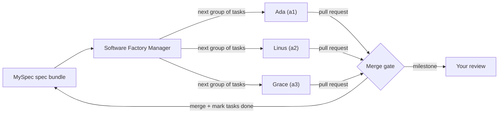

# myspec-factory: a Software Factory for Spec Driven Development (SDD)

**A Software Factory for Claude Code, built on Spec Driven Development (SDD).** This plugin turns Claude Code into a **Software Factory Manager**: a manager that runs a [MySpec](https://myspec.dev) spec bundle to completion. It starts a team of Claude Code agents, shares the tasks out evenly between them, checks and merges the pull requests they open, marks tasks done on MySpec, and stops at each milestone for your review.

## What is a Software Factory?

A Software Factory is a setup where many AI coding agents build one product at the same time, under one manager, from one shared spec.

- **One spec.** The MySpec spec bundle (constitution, requirements, solution, tasks) says what to build. It is the single source of truth, as in any Spec Driven Development (SDD) workflow.
- **One manager.** A Claude Code session with the Software Factory Manager output style plans the work, hands it out, checks the results, and merges them. It never writes feature code.
- **A team of agents.** You choose how many. Each agent has a name (Ada, Linus, Grace, …), which is also its session's title, so you can tell them apart on claude.ai/code and on the board. Each agent is a separate Claude Code session (in the cloud, or on your machine as a fallback) that stays for the whole run. It gets one group of related tasks at a time, builds it on its own branch, opens a pull request, and then gets its next group.
- **Gates, not trust.** Nothing is merged until it passes the merge gate, and every milestone stops for your review.

### Spec Driven Development at factory scale

| | One session (`myspec-mcp`) | Software Factory (`myspec-factory`) |
|---|---|---|
| Who writes code | Your Claude Code session | A team of agent sessions working in parallel |
| Tasks at a time | One | One group of related tasks per agent, all agents at once |
| How work lands | Commits in your checkout | One reviewed pull request per group |
| Who marks tasks done | The session, after its tests pass | The manager, after the merge gate passes |
| Best for | Small specs, hands-on work | Large specs, many independent tasks, unattended shifts |



## Why use the Software Factory

- **Faster delivery.** Independent tasks are built in parallel instead of one after another, and the work is shared out evenly so no agent sits idle while another has a long queue.
- **Spec-first by design.** Nothing starts until the spec passes its check, and every pull request is judged against its tasks' acceptance criteria and the constitution.
- **Safe merges.** No auto-merge, no force pushes, no bypassing branch protection; one merge at a time, after review, checks, and CI/CD.
- **You stay in control.** You choose how much the manager may do on its own, answer questions in one place (the factory board), and approve every milestone.
- **Clear costs.** You pick the team size, and the manager shows each agent's share of the work before it starts them.
- **Runs while you sleep.** Scheduled shifts integrate finished work and give free agents their next tasks.

## Overview

[MySpec](https://myspec.dev) produces a spec bundle (constitution, requirements, solution, tasks). The `myspec-mcp` plugin lets one Claude Code session build it task by task. This plugin adds the layer above that. The manager never writes feature code. It:

1. Groups related tasks (a chain of dependent tasks, tasks that touch the same code, tasks for the same requirement) so one agent does them together in one pull request. For a brownfield bundle without `tasks.md`, it first writes the task list itself.
2. Starts a team of agents (you choose how many): Claude Code cloud sessions, or local sessions only when the cloud is not allowed or not available.
3. Shares the groups out evenly between the agents, by size, and gives each agent one group at a time. When an agent finishes early, it takes work from the busiest agent.
4. Checks each pull request against its tasks' acceptance criteria and the constitution.
5. Merges under the policy you agree on, marks its tasks done on MySpec, and gives the agent its next group.
6. Stops at the end of each milestone for your review.

It can also run unattended shifts on a schedule.

## Features

- **Software Factory Manager output style**: a clear role with hard limits (no work starts on an unfinished spec, no coding, no marking tasks done without checking, no force pushes, no auto-merge), the run loop, milestone gates, and a cost estimate before the team starts.
- **Task planning for brownfield changes**: when a bundle has no `tasks.md`, the manager writes one, with independent parts as separate tasks so several agents can share them. You approve it before it is uploaded to MySpec.
- **A team of named agents**: you choose the team size. Each agent gets a name, and its session is titled with it (`Ada (a1)`) instead of a title the AI makes up. Related tasks go to one agent, one branch and one pull request, which saves review rounds and avoids conflicts between branches. The groups are shared out evenly by size; an agent that runs out of work takes some from the busiest one. Each agent stays for the whole run, so it sets up once and keeps what it learned about the code. The task board comes from MySpec checkboxes and open pull requests, so it is never out of date.
- **Self-contained instructions**: each agent gets the rules for the run once, then one message per group of tasks: the tasks, their acceptance criteria, the requirements and decisions they depend on, and what the pull request must contain.
- **Model and effort per agent**: Opus at medium effort by default, Sonnet for an agent whose work is all small and mechanical, Opus at high or extra-high effort for hard work or a replacement after a failure. The plan shows the choice for each agent before anything starts.
- **Integration**: required checks, a test for each acceptance criterion, a constitution and scope review, a merge under the agreed policy, then `[x]` written to MySpec.
- **Factory board**: one private claude.ai page for the repository (several repositories may share one), reused by every run and shared by the manager and every agent (no other pages are created), where every agent posts progress, asks questions without stopping, and copies its report, and where the manager answers and posts each agent's next tasks. You see each agent's current work, its queue and what it has merged in one place, and can step in with a comment. The log shows whether the manager or an agent wrote each message, and the comment panel shows which comments are yours.
- **Live event feed**: changes to `tasks.md` and other spec files and finished spec sessions arrive as notifications instead of polling.
- **Scheduled shifts**: a cloud routine that integrates, marks tasks done, and gives free agents their next tasks on a schedule.

## Prerequisites

- Claude Code with plugin support (`/plugin` works).
- The [`myspec-mcp`](../myspec-mcp/README.md) plugin installed and signed in. The manager reads and writes the spec bundle through it.
- Node.js 22 or newer.
- The GitHub CLI (`gh`) signed in with push and pull-request rights on the target repository.
- A local clone of the target repository, with its default branch pushed to GitHub.

For **cloud agents** (optional, recommended):

- Claude Code on the web enabled for your account.
- The [Claude GitHub App](https://github.com/apps/claude) installed on the repository.
- A cloud environment at claude.ai/code with `MYSPEC_API_TOKEN` set, if agents need to read MySpec.
- A clone of the repository that you have opened in Claude Code before (the manager starts cloud agents from it).

For **local agents** (fallback):

- The `claude` CLI and git worktrees.
- A MySpec API token for the agents (see [Configuration](#configuration)).

## Installation

### 1. Install both plugins

Inside Claude Code:

```text
/plugin marketplace add myspecs/claude-plugins
/plugin install myspec-mcp@myspec
/plugin install myspec-factory@myspec
```

Or from a terminal:

```bash
claude plugin marketplace add myspecs/claude-plugins
claude plugin install myspec-mcp@myspec
claude plugin install myspec-factory@myspec
```

Install `myspec-factory` only on the machine that runs the manager. Agent sessions need `myspec-mcp` only.

### 2. Restart Claude Code and sign in to MySpec

```bash
npx -y @myspec/mcp-server login
```

Run it in a terminal, or inside Claude Code with the `!` prefix. `/mcp` should show `myspec` as connected. See the [myspec-mcp README](../myspec-mcp/README.md#installation) for API tokens and organizations.

### 3. Prepare the repository

In your clone of the target repository, start Claude Code and run:

```text
/myspec-factory:setup
```

It checks MySpec and GitHub access, cloud readiness, and branch protection, then proposes repository settings so agents load `myspec-mcp`. It writes nothing until you approve. At the end it lists the MySpec projects you can access, asks you to pick one, and opens that project's live event feed, so you can start a run straight away.

### 4. Turn on the manager persona

The output style is off by default, so sessions that should write code keep the normal style. Turn it on for the managed repository only.

Either use `/config` → Output style → **Software Factory Manager**, or add this to the repository's `.claude/settings.local.json`:

```json
{ "outputStyle": "myspec-factory:Software Factory Manager" }
```

Use the full name `myspec-factory:Software Factory Manager` in settings files.

### 5. Start the manager with Remote Control

Remote Control lets the manager see its cloud agents and whether each is busy:

```bash
claude --remote-control "factory <bundle>"
```

Or run `/remote-control` inside a running session.

### 6. Start a run

```text
Run the factory for project X, bundle Y.
```

### Update or remove

```text
/plugin marketplace update myspec
/plugin update myspec-factory@myspec
```

Restart Claude Code after updating. To remove: `/plugin uninstall myspec-factory@myspec`.

## Components

### Output style

**Software Factory Manager** (`output-styles/software-factory-manager.md`). Keeps Claude's git and verification skills but forbids implementing tasks.

### Skills

| Skill | Invoke | Purpose |
|---|---|---|
| `setup` | `/myspec-factory:setup` | Check MySpec and GitHub access and cloud readiness; propose repository settings so agents load `myspec-mcp`; pick a MySpec project and open its event feed |
| `watch` | Used by the manager | Open the project's live event feed and react to each event; polls when the feed is not available |
| `plan` | Used by the manager | Build the task board, group related tasks, propose the team size and share the groups out evenly; write `tasks.md` when a brownfield bundle has none |
| `dispatch` | Used by the manager | Run the team: start the agents (cloud first, local as fallback), send each its next group of tasks, rebalance, replace an agent after a failure |
| `integrate` | Used by the manager | Verify and merge the agents' pull requests (a gate script checks approval on the latest commit, checks, threads, holds, base drift and migration order), mark tasks done on MySpec, run the milestone gate |
| `board` | Used by the manager | Publish or reuse the factory board, read and answer the agents' posts, handle your comments, and clean up finished work; holds the page template and sample calls |
| `shift` | Used by the manager | Draft and create a scheduled cloud routine that runs one unattended pass of the team |

The manager also uses `myspec-mcp:implement` (how progress is written back) and `myspec-mcp:analyze` (the code-to-spec check at milestone gates).

## A run, end to end

1. Run `/myspec-factory:setup` in the repository and approve the settings it proposes.
2. Switch to the Software Factory Manager style and ask: "Run the factory for project X, bundle Y."
3. The manager opens the event feed, then asks once for the team size (it recommends one), the merge method, how much it may do without asking (the autonomy level, below), whether cloud sessions are allowed, and who settles minor implementation details (`minor_defaults`: you, or the manager with each choice recorded as a reversible Clarification). It checks that the spec is complete and asks you about every open question or doubt, bundling small defaults into one approve-or-change question; no agent starts until that passes. Then it shows how it shares the work between the agents (each agent's queue, its size, and the model it uses) and tells you the cost. For a brownfield bundle without `tasks.md`, it first drafts the task list and asks for your approval.
4. Before the first agent starts, the manager opens the repository's factory board (publishing it the first time) and gives you its link. Agents post progress and questions there while they work, then open pull requests titled `task N1, N2, …: <summary>` (or `task N: <title>` for a single task) with a `## Factory report` at the end.
5. The manager verifies each pull request, merges it once it passes the merge gate, watches the deploy, marks its tasks `[x]` on MySpec, and gives the agent its next group of tasks. An agent can start its next group while its last pull request waits for review.
6. At the end of a milestone it runs the test suite, checks the code against the spec, uploads a milestone summary, drafts the spec corrections and follow-up tasks, and asks you one question about what to apply and start. The same agents then take on the next milestone.

### Autonomy levels

| Level | Merges | Gives agents their next tasks |
|---|---|---|
| `ask-each` | Asks before every merge | Asks each time |
| `merge-on-gate` (recommended) | Merges on its own once the gate passes | Asks each time |
| `full` | Merges on its own once the gate passes | On its own, within the same milestone, once what the tasks wait for has merged and deployed |

At every level the manager still asks you about spec questions, changes an agent made beyond the spec, rewrites of spec documents, and starting the next milestone. The merge gate is the same at every level: the reviewer approved the pull request's latest commit, required checks are green, review threads are resolved, the pull request merges cleanly with auto-merge off, the manager's own verification covers every change, and no spec question is open.

## What agents deliver

For each group of related tasks: one branch, one pull request, titled `task N1, N2, …: <summary>`, with one commit per task. A task with nothing related to it is a group of its own, with a pull request titled `task N: <title>`. Tests are named after each acceptance criterion, and the body ends with a `## Factory report`; the pull request's report is the one the merge is judged on. While it works, an agent also posts progress to the factory board after each task, asks its questions there and keeps working on the rest, and copies its report there. When an agent cannot finish a group, the report starts with `BLOCKED: spec` or `BLOCKED: env`. Agents never edit `tasks.md` or other spec files, and never start a task they were not given.

### Using the factory board

- **Waiting on you** lists the questions only you can answer. Answer in a comment (the **Answer in a comment** button, or comment mode on the page).
- Choose **Send to Claude** on your comment to reach the manager right away while agents are active or a question waits for you. When nothing has been running for about half an hour, the manager pauses its board watch (it tells you) and reads comments when work resumes; you can always reach it in the terminal. A plain comment is read at the manager's next check, and it asks before acting on it.
- Only the manager replies to comments. Claude Code may post a short automatic reply first; the manager's own replies start with `## Software Factory Manager`. It records your decisions and passes them to the agents, and the log marks them **Owner's words, relayed**.
- Each agent has a card showing what it works on now, its queue, and what it has merged. A comment on an agent's card is about that agent.
- A repository has one board, and the same link is reused for all later work in it. Several repositories may share one board; it then serves one run at a time. The manager asks, then saves the link in a marked block of the repository's `CLAUDE.md` and commits it the way you choose (a small pull request, a direct commit, or leaving it uncommitted in your clone), so later sessions and fresh clones find it instead of creating a new board. The manager clears handled messages once a pull request merges and everything important is recorded on the pull request and in the spec, and resolves the comment threads it handled. It cannot resolve or delete comments you did not send to Claude; it lists those so you can clear them in the comment panel.
- The board is private to your account. Keep it that way: agents act only on entries from the manager, and anyone you share it with could add comments.

## Safety and cost

- The manager asks before writing repository settings or creating routines, and never merges outside the agreed policy. It asks before starting sessions unless you chose the `full` autonomy level for the run.
- Parallel sessions share your account's rate limit. You choose the team size, and the manager never runs more agents than that. An agent that is waiting for work costs nothing.
- No force pushes, no bypassing branch protection, no merging red pull requests, no auto-merge. It merges one pull request at a time and waits for that merge's CI/CD before the next.

## Usage examples

```text
Set up the factory for this repository.
Run the factory for project "inventory-service", bundle "v1".
How many agents do we need, and how would you split the work?
Start a team of 3 agents in the cloud.
Rebalance: Linus is idle.
Integrate the open factory pull requests.
Schedule a factory shift every night at 2am.
```

## Configuration

| Setting | Where | Purpose |
|---|---|---|
| `outputStyle: "myspec-factory:Software Factory Manager"` | `.claude/settings.local.json` of the managed repository | Turns on the manager persona for that checkout only |
| Remote Control (`claude --remote-control` or `/remote-control`) | The manager's session | Lets the manager list its cloud agents and see whether each is busy |
| Team size, merge method, autonomy level, cloud allowed, `minor_defaults` | Asked once per run, stored under `policy` in `.specs/<bundle>/factory-sessions.json` | Limits for the whole run; tell the manager to change the autonomy level at any time |
| `extraKnownMarketplaces` and `enabledPlugins` | Repository `.claude/settings.json` (written by `setup` when you approve) | Lets agents load `myspec-mcp` |
| `MYSPEC_API_TOKEN` | Cloud environment at claude.ai/code | MySpec access for cloud agents and scheduled shifts (they cannot use browser sign-in) |
| `MYSPEC_API_TOKEN` | `env` in the managed repository's gitignored `.claude/settings.local.json` | MySpec access for local agents. A separate token keeps agents off the manager's browser sign-in, which two servers cannot share |
| `.specs/<bundle>/factory-sessions.json` | Local, gitignored | Record of the team: each agent's session, model, queue and assignments (tasks, branch, pull request, status), and the factory board's link |
| `.specs/<bundle>/factory-run.md` | Local, gitignored | Run log and task board cache |

Add `.specs/` to the repository's `.gitignore`.

## Troubleshooting

| Problem | Fix |
|---|---|
| **Software Factory Manager** is not in the output style list | Check `myspec-factory` is enabled in `/plugin`, then restart Claude Code. In settings files use `myspec-factory:Software Factory Manager`. |
| The manager writes code or skips its checks | The style is not active. Switch with `/config`; a change in a settings file only applies to new sessions. |
| The manager and local agents both lose MySpec access (`Refresh token rejected`, then `Not authenticated`) | They shared one browser sign-in. Give local agents their own `MYSPEC_API_TOKEN` in `.claude/settings.local.json`, then reconnect the manager's server in `/mcp`. |
| An agent's token fails with `API token exchange failed … invalid, disabled, or expired` | The token is revoked, expired, or from a different organization. Create a token in the organization that owns the project. |
| Cloud agents are refused | Your plan or organization does not allow cloud sessions. Enable Claude Code on the web, or let the manager use local agents. |
| A cloud agent never starts, and the manager's output shows a folder trust question | The manager starts cloud agents from a clone Claude Code has not trusted yet. Open Claude Code once in that clone and accept the trust question, or point the manager to a clone you already use. |
| Cloud agents do not show up in the manager's agent list | Connect Remote Control (`/remote-control`) in the manager session. The manager messages cloud agents with `claude -p "<message>" --cloud <session_id>` either way. |
| A cloud agent's session title is not its name (`Ada (a1)`) | The manager sets it when the agent starts and renames it if the cloud picked another title. If it still shows another title, tell the manager; the agent's name stays right on the board and in the manager's reports either way. |
| A cloud agent sits "waiting on a human" | Open its session on claude.ai/code and let it continue. The manager messages cloud agents only with `claude -p … --cloud`, which does not cause this. |
| Cloud agents cannot reach MySpec | Add `MYSPEC_API_TOKEN` to the cloud environment and allow network access to npm and the MySpec hosts. The manager's messages already include the needed spec text, so this only matters when an agent must read more. |
| Agents have no MySpec tools | The repository settings from `setup` are missing or not pushed. Cloud sessions clone the branch from GitHub, so commit and push `.claude/settings.json`. If agents still have no tools, run `setup` again; it offers a root `.mcp.json` as a fallback. |
| Two sets of MySpec tools in an agent | The repository enables `myspec-mcp` and also declares `myspec` in a root `.mcp.json`. Keep the plugin entry and remove the `.mcp.json` server. |
| Auto-fix is not offered on an agent's pull request | Install the [Claude GitHub App](https://github.com/apps/claude) on the repository. Without it, agents only react to checks and reviews when the manager forwards them. |
| A green pull request never gets a bot review | No review was requested. Run `gh pr edit <n> --add-reviewer <bot>`. |
| The manager created a second board | The link was not committed. Commit the `<!-- myspec-factory:start -->` block in `CLAUDE.md` that the manager wrote, and delete the extra board (ask the manager, or use `/artifacts`). |
| No factory board link, or agents report `- Board: unavailable` | The board needs Claude Code signed in to claude.ai (not an API key) in the manager and the agents. Without it the run continues; agents report through pull requests only. |
| The manager did not answer a board comment | Only comments sent with **Send to Claude** wake the manager; plain comments wait for its next check. After a manager restart, paste the board link into the manager's session so comments reach it again. |
| An entry on the board is marked **Unverified sender** | It was written with the wrong key: an agent writing outside its own mailbox, or an old session that the manager replaced. The manager ignores it and tells you. |
| The event feed went quiet | The connection dropped. Ask the manager to reopen the feed ("reopen the event feed"); it creates a new token and revokes the old one. |
| A deployment runs an older commit after two quick merges | Workflows that build a shared tag such as `:latest` raced. Re-run the workflow for the newest merge commit. |
| A scheduled shift ran but did nothing | Read the routine's run log. The usual causes are a missing `MYSPEC_API_TOKEN` in the cloud environment, or a repository that was not prepared with `/myspec-factory:setup`. |

For MySpec sign-in and connection errors, see the [myspec-mcp troubleshooting](../myspec-mcp/README.md#troubleshooting).

## FAQ

**What is a Software Factory in Claude Code?**
A way to build a whole spec with many Claude Code sessions at once. One manager session plans and checks the work; a team of agent sessions writes the code and opens pull requests.

**How does the Software Factory relate to Spec Driven Development (SDD)?**
It is SDD at scale. The spec bundle on MySpec decides what gets built, every task traces back to a requirement, every pull request is checked against acceptance criteria, and tasks are marked done in the spec only after they merge.

**Does the manager write code?**
No. The Software Factory Manager output style forbids it. The manager plans, hands out tasks, verifies, merges, and reports.

**Do I need cloud sessions?**
No, but they are recommended. Without Claude Code on the web, the manager starts the agents on your machine instead.

**Will it merge pull requests on its own?**
Only if you allow it. With `ask-each` it asks before every merge. With `merge-on-gate` or `full` it merges on its own, but only after the merge gate passes. Auto-merge is never turned on.

**Can I use it on an existing codebase?**
Yes. For a brownfield change proposal without `tasks.md`, the manager writes the task list and asks you to approve it before uploading.

**What does a run cost?**
Each agent is a normal Claude Code session on your account and shares its rate limit. You choose the team size; the manager shows each agent's share of the work before it starts them and never runs more agents than you allowed.

**How is the work shared between the agents?**
The manager groups related tasks, weighs each group by the size of its tasks, and gives each agent an even share. Each agent gets one group at a time; when it finishes, it gets its next one. If an agent runs out of work while another still has a long queue, the manager moves a group over.

**What happens when an agent fails?**
The manager replaces that agent's session with a new one at a stronger model setting. The new session continues the failed work on the same pull request and takes over the rest of the queue.

## License

MIT. See [LICENSE](LICENSE).
